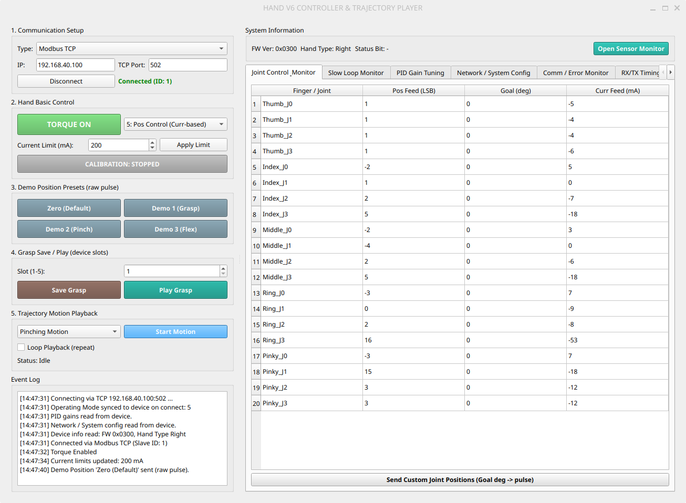

## RUN 

```bash
DISPLAY=:1 XDG_RUNTIME_DIR=/run/user/1000 WAYLAND_DISPLAY=wayland-0 QT_QPA_PLATFORM=wayland uv run --with pyqt6 --with pymodbus --with pyserial --with numpy gui.py
```

## Seq. 


1. connect 
2. torque on 
3. apply current limit
4. zero 